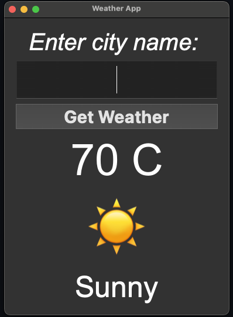
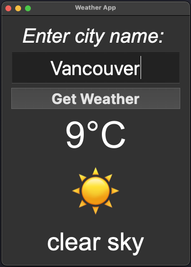

# Weather App

A desktop app that looks up the current weather for a city. The interface is built with PySide6, and weather data comes from the [OpenWeatherMap Current Weather API](https://openweathermap.org/current).

Enter a city name and click **Get Weather**. The app shows the temperature in °C, a short description, and a matching emoji. If the request fails, the error message replaces the temperature.

## Screenshots




## Requirements

- Python 3.10 or newer (`match` / `case`)
- A free API key from [OpenWeatherMap](https://openweathermap.org/api)

## Setup

```bash
python3 -m venv .venv
source .venv/bin/activate
pip install -r requirements.txt
cp .env.example .env
```

On Windows, activate the environment with `.venv\Scripts\activate`.

Open `.env` and add your key:

```
OPENWEATHER_API_KEY=your_api_key_here
```

You can set the `OPENWEATHER_API_KEY` environment variable instead of using a `.env` file. Do not commit `.env`.

## Run

```bash
python main.py
```

## How it works

`get_weather` calls:

```
https://api.openweathermap.org/data/2.5/weather?q={city}&appid={key}
```

OpenWeather returns the temperature in Kelvin. The app converts it to Celsius with `temp - 273.15` and rounds to the nearest integer.

The emoji comes from `weather[0].id`, using OpenWeather condition codes:

| Code | Meaning | Emoji |
| --- | --- | --- |
| 200–232 | Thunderstorm | ⛈ |
| 300–321 | Drizzle | ⛅︎ |
| 500–531 | Rain | 🌧️ |
| 600–622 | Snow | ❅ |
| 701–741 | Mist, smoke, haze | 🌫️ |
| 762 | Volcanic ash | 🌋 |
| 771, 781 | Squall, tornado | 💨 |
| 800 | Clear | ☀ |
| 801–804 | Clouds | ☁️ |

Emoji text uses Apple Color Emoji on macOS, Segoe UI Emoji on Windows, and Noto Color Emoji on Linux.

## Error messages

| Situation | Message |
| --- | --- |
| Missing API key | Missing API key: Set OPENWEATHER_API_KEY in a .env file |
| HTTP 400 | Bad request: Please check your input |
| HTTP 401 | Unauthorized: Invalid API key |
| HTTP 403 | Forbidden: Access is denied |
| HTTP 404 | Not found: City not found |
| HTTP 500 | Internal server error: Please try again later |
| HTTP 501 | Not implemented: The server does not support this request |
| Other HTTP error | HTTP error: followed by the error text |
| No network | Connection error: Check your internet connection |
| Request timed out | Timeout error: The request timed out |
| Too many redirects | Too many redirects: Check the URL |
| Other request error | Request Error: followed by the error text |

## Project layout

```
main.py           interface and API calls
requirements.txt  PySide6 and requests
.env.example      sample environment variable
screenshots/      app screenshots used in this README
```

`.venv/`, `.idea/`, and `.env` are listed in `.gitignore`.
